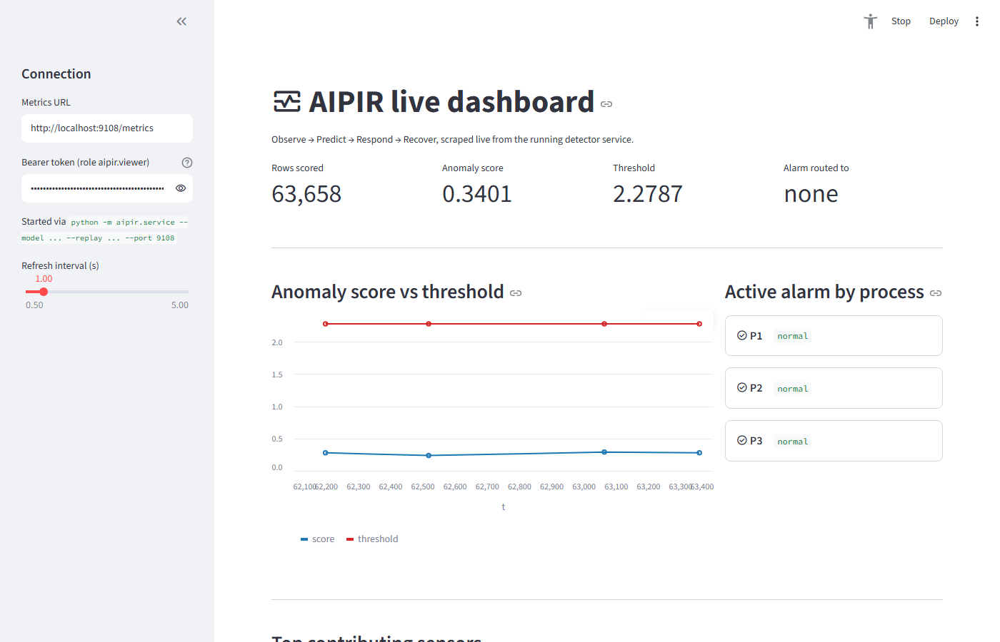

# AIPIR - AI-Enabled Predictive Infrastructure Resilience Framework

[](https://doi.org/10.5281/zenodo.23846614)

**Status: v0.2.0 released** - see the DOI badge and CITATION.cff.

AIPIR is an open, cloud-native framework that connects **detection, response and recovery** for
energy-sector control systems in one reproducible loop:

| Layer | What it does | Where |
|---|---|---|
| 1 Observe | Reads 1 Hz plant telemetry; Prometheus metrics plus OpenTelemetry metrics, traces (one span per alarm and per recovery) and logs | `framework/aipir/service.py`, `otel.py`, `deploy/observability/` |
| 2 Predict | Ridge forecaster predicts every sensor 1 s ahead from 30 s of history; robust, causal residual score | `framework/aipir/detectors.py` |
| 3 Respond | Threshold calibrated on normal data only (1 alarm/day); debounced alarms routed to boiler / turbine / water process; authenticated Alertmanager webhook | `framework/aipir/metrics.py`, `routing.py`, `deploy/observability/` |
| 4 Recover | Recovery requests with two-person approval run Ansible playbooks (check mode by default); Terraform and Kubernetes restore the stack; signed configuration baseline and drift check | `framework/aipir/recovery.py`, `drift.py`, `deploy/ansible/`, `deploy/terraform/` |
| Zero-Trust | Signed tokens on every call (Entra ID in a pilot), RBAC from a policy file, MFA for sensitive actions, two-person rule, hash-chained audit log, default-deny networking | `framework/aipir/zerotrust.py`, `deploy/zero-trust/` |

It is validated on the open **HAI** security datasets (a hardware-in-the-loop testbed emulating
steam-turbine power generation and pumped-storage hydropower) against three baselines, with every
threshold set to the same false-alarm budget and all design choices frozen on one development file.

## Headline results (held-out data)

HAI 21.03, 45 attacks over 4.2 days:

| Detector | Attacks detected | Median time-to-detect (s) | Point-wise F1 | False alarms/day | Routed to attacked process |
|---|---|---|---|---|---|
| Static limits | 37/45 | 19 | 0.57 | 0.00 | 100% |
| PCA residual | 40/45 | 33 | 0.68 | 0.48 | 80% |
| Isolation Forest | 0/45 | - | 0.00 | 0.00 | - |
| **AIPIR predictive** | 35/45 | 16 | 0.69 | 0.72 | 100% |

HAI 20.07 (replication), 38 attacks over 5.1 days:

| Detector | Attacks detected | Median time-to-detect (s) | Point-wise F1 | False alarms/day | Routed to attacked process |
|---|---|---|---|---|---|
| Static limits | 20/38 | 70 | 0.13 | 0.00 | 100% |
| PCA residual | 27/38 | 58 | 0.55 | 18.46 | 100% |
| Isolation Forest | 25/38 | 120 | 0.32 | 16.13 | - |
| **AIPIR predictive** | 21/38 | 68 | 0.45 | 0.39 | 86% |

**Read honestly:** On HAI 21.03, AIPIR detects attacks earliest and routes them correctly, with the best F1 on
HAI 21.03, but static limits and PCA detect *more* attacks; on HAI 20.07 every detector is weak.
The detectors miss different attacks, so AIPIR is best used as a layer on top of existing alarms.

**Downtime scenario** (assumed recovery times, not measured; `code/03_recovery_scenario.py`):
relative to static alarms with manual recovery, AIPIR with automated recovery cuts total downtime
over the 83 held-out attacks by 19.4% (range
0.6-49.9% across assumptions); AIPIR with
manual recovery changes it by +2.5%; an exploratory layered setup (static limits + AIPIR)
cuts it by 49.5%. See `docs/LIMITATIONS.md`.

## Platform checks (lab)

- **Zero-Trust, recovery and OpenTelemetry end to end:** 29/29 checks passed
  (`tests/integration/lab_stack_check.py`, against a live OpenTelemetry Collector, with Ansible
  in check mode).
- **IaC template library:** 14 templates; 18 validation checks passed, 0 failed,
  0 skipped (`deploy/validate.sh`, using terraform/OpenTofu, promtool, amtool, otelcol,
  ansible-playbook and kubeconform).
- **Configuration drift:** unapproved edits, approved changes, a tampered baseline and a swapped
  container image are all classified correctly (`tests/integration/drift_demo.py`).

These checks show the software works as designed in a lab. They are not pilot results: the SOW's
measured targets (MTTD, MTTR, availability, misconfigurations, the 5 TB dataset) stay open until
the site pilot produces them. See `docs/SOW_TRACEABILITY.md`.

## Reproduce

```bash
pip install -r requirements.txt          # Python 3.12-3.13; Node 18+ for the manuscript (npm i docx)
./run_all.sh                             # fetch HAI at a pinned commit, fit, evaluate, QA, figures, paper
python -m pytest -q tests                # unit tests (synthetic data, seconds)
```

Outputs: `data/processed/` (scores, events, metrics, `qa_report.txt`), `paper/stats.json`,
`paper/figures/`, `paper/tables/`, `paper/AIPIR_manuscript.docx`. Every number in the paper and in
this README is read from `paper/stats.json`.

## Run the framework (lab mode)

```bash
# detector service replaying a held-out HAI file at 60x
source docs/training/lab_env.sh          # lab secret + one token per role
python -m aipir.service --model models/aipir_hai2103.joblib \
    --replay data/raw/hai-21.03/test2.csv.gz --speed 60 --port 9108 &
api GET /metrics "$SCRAPER"

# full stack: detector + OTel Collector + Prometheus + Alertmanager + Grafana
./deploy/compose/gen-lab-secrets.sh
docker compose -f deploy/compose/docker-compose.yml up --build

# any Kubernetes cluster (cloud or plant edge), and the Entra ID identity controls
terraform -chdir=deploy/terraform/environments/lab-k8s init && terraform -chdir=deploy/terraform/environments/lab-k8s apply
terraform -chdir=deploy/terraform/environments/azure-entra init && terraform -chdir=deploy/terraform/environments/azure-entra apply
```

Every endpoint except `/healthz` needs a token. For lab tokens, see `deploy/README.md` or
`source docs/training/lab_env.sh`. Recovery runs in **dry-run** mode by default. In execute
mode a second person must approve, and Ansible still runs in check mode until the site signs
off. Nothing writes to a control system. See `deploy/RUNBOOK.md`.

## Live dashboard

A small Streamlit app (`dashboard/app.py`) polls the detector service's `/metrics` endpoint and
shows the anomaly score vs. threshold, the alarm status per process, and the top contributing
sensors, refreshing every second:



### Clone and run it locally

```bash
# 1. Clone the repo and install dependencies
git clone https://github.com/foikwuogu/aipir.git
cd aipir
pip install -r requirements.txt
pip install -r dashboard/requirements.txt

# 2. Fetch the HAI replay data (only needed once)
python code/01_fetch.py

# 3. Start the detector service in lab mode (mints Zero-Trust tokens for you)
source docs/training/lab_env.sh
python -m aipir.service --model models/aipir_hai2103.joblib \
    --replay data/raw/hai-21.03/test2.csv.gz --speed 60 --port 9108 &

# 4. Launch the dashboard, pointing it at the service with a viewer token
export AIPIR_VIEWER_TOKEN=$VIEWER_TOKEN   # set by lab_env.sh, role aipir.viewer
streamlit run dashboard/app.py
```

On Windows (PowerShell), set `PYTHONPATH` to the `framework` folder and mint a viewer token
yourself instead of sourcing the bash script:

```powershell
git clone https://github.com/foikwuogu/aipir.git
cd aipir
pip install -r requirements.txt
pip install -r dashboard/requirements.txt
python code/01_fetch.py

$env:AIPIR_ENV = "lab"; $env:AIPIR_AUTH_MODE = "hs256"; $env:AIPIR_LAB_SECRET = "<any-string>"
$env:PYTHONPATH = "$PWD\framework"
python -m aipir.service --model models/aipir_hai2103.joblib `
    --replay data/raw/hai-21.03/test2.csv.gz --speed 60 --port 9108

# in a second terminal, with the same AIPIR_* env vars set
$env:AIPIR_VIEWER_TOKEN = (python -m aipir.zerotrust mint --sub viewer --role aipir.viewer --ttl 86400)
streamlit run dashboard/app.py
```

Then open http://localhost:8501. The sidebar lets you change the metrics URL, paste a different
bearer token, and adjust the refresh interval.

## Data and sources

- HAI security dataset, versions 21.03 and 20.07, https://github.com/icsdataset/hai at commit
  `2a814ce`, CC BY-SA 4.0. Please cite: Shin, Lee, Yun, Min, *Two ICS Security Datasets and Anomaly
  Detection Contest on the HIL-Based Augmented ICS Testbed*, CSET '21, doi:10.1145/3474718.3474719.
  Provenance (SHA-256 per file) in `data/raw/PROVENANCE.txt`.
- No employer, operator or customer data is used anywhere in this project.

## Repository map

| Path | Contents |
|---|---|
| `code/` | Numbered pipeline (01 fetch ... 08 README) |
| `framework/aipir/` | Detectors, streaming scorer, service, Zero-Trust, OpenTelemetry, recovery/Ansible hook, drift check, KPI calculator |
| `deploy/` | **IaC template library** (index in `deploy/README.md`): Terraform modules and environments, Kubernetes manifests, Docker/Compose, observability configs, Ansible, Zero-Trust policy, drift baseline, runbook, `validate.sh` |
| `docs/REPLICATION_PLAYBOOK.md` | **Open-access replication playbook** for other facilities, including the KPI protocol |
| `docs/training/` | **Training package**: curriculum, slide deck, six labs, instructor guide with recording script, quiz, evaluation |
| `docs/SOW_TRACEABILITY.md` | Each SOW item: built, built and awaiting pilot, or open |
| `docs/` (other) | Build spec, codebook, limitations, verification checklist, next steps, publish guide |
| `tests/` | Unit tests, Prometheus alert tests, lab integration checks |
| `paper/` | Stats, figures, tables, manuscript |
| `models/` | Fitted models (CC BY-SA 4.0) |

## License

Code MIT (`LICENSE`); derived data and models CC BY-SA 4.0 (required by HAI); paper and docs
CC BY 4.0. Details in `LICENSE-DATA.md`.

## Citation and contact

Friday Ogochukwu Ikwuogu; Silas Abutu; Ayodeji Olutosin Ejiade; Fejiro Eni. *AIPIR: AI-Enabled Predictive Infrastructure Resilience Framework*, v0.2.0, 2026.
doi:10.5281/zenodo.23849300 (all versions: doi:10.5281/zenodo.23846614). See `CITATION.cff`. Maintainer: Friday Ogochukwu Ikwuogu (Friday.ikwuogu@gmail.com,
ORCID 0009-0009-2222-1318).
